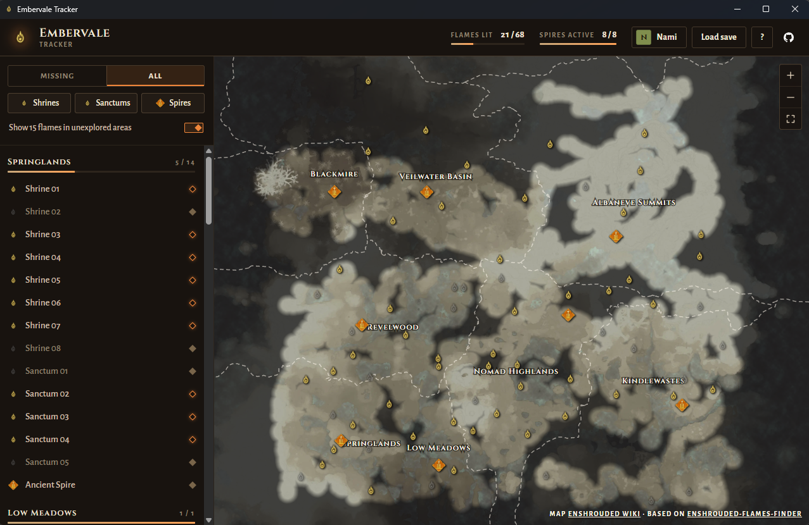
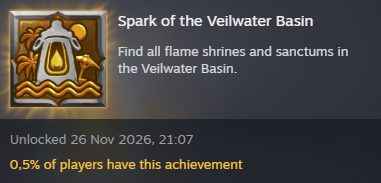

# Embervale Tracker

See which Flame Shrines, Flame Sanctums and Ancient Spires you still have to find in Enshrouded.

Embervale Tracker shows a map of Embervale with every Flame Shrine, Flame Sanctum and Ancient Spire. Load your save and it marks the ones you have found and the ones you are still missing, with your own fog of war on the map.



Embervale Tracker is based on [enshrouded-flames-finder](https://github.com/quantumsheep/enshrouded-flames-finder) by quantumsheep, and is licensed under the same Apache License 2.0.

## Why does this project exist?

Some Steam achievements, such as Spark of the Veilwater Basin, ask you to find every Flame Shrine and Flame Sanctum in a region:



They are tedious to complete because the in-game map shows visited and unvisited Flame Shrines and Flame Sanctums with the same icon. Embervale Tracker marks the ones you have found, so you can see which ones you still have to visit.

## Get started

You can use Embervale Tracker in two ways. Both show the same map.

### In your browser

Open **[hinneman.github.io/embervale-tracker](https://hinneman.github.io/embervale-tracker/)**. There is nothing to install. You load your save file yourself, see [Where to find your save](#where-to-find-your-save).

### As a desktop app for Windows or Linux

The desktop app finds your saves on its own and updates the map each time the game saves, so you can keep it open while you play.

1. Open the **[latest release](https://github.com/Hinneman/embervale-tracker/releases/latest)**.
2. Under **Assets**, download the file for your computer:

   | Your computer       | File to download                                        |
   | ------------------- | ------------------------------------------------------- |
   | Windows             | `Embervale.Tracker_…_x64-setup.exe` (installer)         |
   | Windows, no install | `embervale-tracker_…_x64-portable.exe` (runs as it is)  |
   | Linux               | `Embervale.Tracker_…_amd64.AppImage` (any distribution) |
   | Debian or Ubuntu    | `Embervale.Tracker_…_amd64.deb`                         |

3. Open the file you downloaded.

**Windows shows "Windows protected your PC"?** The app is not signed with a paid certificate, so Windows does not know it yet. Click **More info**, then **Run anyway**.

**On Linux,** an AppImage must be allowed to run first: right-click it, open **Properties** and turn on **Allow executing file as program**, or run `chmod +x` on it.

The app only reads your save files. It never changes them. See also the [code signing policy](#code-signing-policy).

## How to use it

1. **Load your save.**
   - **Desktop app:** on the first start it lists the characters it found. Pick one. To switch later, use the character button in the top bar.
   - **Browser:** click **Load save** and pick your save file, or drag the file onto the page.
2. **See what you are missing.** The list on the left shows each region with how many locations you have found. Click **Missing** at the top to list only the ones you still have to find.
3. **Find the next one.** Click a location in the list or on the map, and the map zooms to it. In the box that opens, **Next missing** jumps to the next location you have not found yet.

Flames under the fog, on ground you have not explored yet, show on the map too. To keep the surprise, turn off **Show … flames in unexplored areas** at the top of the list.

To move around the map, drag it, and zoom with the mouse wheel or the **+** and **−** buttons.

## Where to find your save

You need this only in the browser. The desktop app finds your saves on its own.

Your character is saved in a file named `character0.ksd`, `character1.ksd` and so on. A `worldN.ksd` file does not work: it holds the world, not your character.

Where the file is depends on whether Steam Cloud is on for Enshrouded. To check, right-click Enshrouded in your Steam library and select **Properties**.

- **Steam Cloud on (the default):** the easiest way is to download the file from your [Steam Cloud storage for Enshrouded](https://store.steampowered.com/account/remotestorageapp/?appid=1203620). You must be logged in to Steam to see this page. The file is also on your PC: open the Steam folder (usually `C:\Program Files (x86)\Steam`; Steam shows it under **Steam > Settings > Storage**), then go to `userdata\<your Steam ID>\1203620\remote`.
- **Steam Cloud off:** copy `%userprofile%\Saved Games\keen games\Enshrouded`, paste it into the File Explorer address bar and press Enter.

On a shared PC with Steam Cloud on, each Steam account has its own `userdata` folder. With Steam Cloud off, all players on the PC share one save folder.

## For developers

### Development

```sh
bun install
bun run dev
```

Other scripts: `bun run build`, `bun test`, `bun run check`, `bun run format`.

### Game data

The locations and region borders come from the game files, which [kfc-parser](https://github.com/Brabb3l/kfc-parser) unpacks to JSON:

```sh
kfc-parser unpack -g <Enshrouded folder> -o <output folder>
```

- **Flame shrines, sanctums and Ancient Spires** (`src/locations.ts`): their positions and knowledge ids are in the world's `SceneResource`. A spire uses the first knowledge id that its fast travel marker unlocks.
- **Region borders** (`src/regions.ts`): generated from the world's biome map, a 1280 × 1280 grid with 8 m cells:

  ```sh
  bun scripts/generate-regions.ts <output folder>/BiomeMapResource/509feadb-4c60-425f-9c7c-deeefd9b6920_6287e034_0.json
  ```

### Desktop app

The app wraps the page in a [Tauri](https://tauri.app) window. It runs on Windows and on Linux, where Enshrouded runs through Steam's Proton. On Windows it uses WebView2, which ships with Windows 10 and 11. On Linux it uses WebKitGTK.

The app lists the `characterN.ksd` files in each Steam account's `userdata/<id>/1203620/remote` folder and in the game's `Saved Games\keen games\Enshrouded` folder, loads the character picked last time, and loads it again when the game saves. It can read only those files and the ones you select or drop on it. On Linux it looks in `~/.local/share/Steam`, `~/.steam/steam` and Flatpak Steam, and finds the `Saved Games` folder in the Proton prefix in each Steam library.

To build it yourself, install [Rust](https://rustup.rs) (and on Linux the [Tauri prerequisites](https://tauri.app/start/prerequisites/)), then run:

```sh
bun run tauri dev    # opens the app window with live reload
bun run tauri build  # writes the installers to src-tauri/target/release/bundle
```

### Releasing

The [release workflow](.github/workflows/release.yml) runs on tags that start with `v`. It checks that the tag matches the app version, runs the checks and tests, builds the Windows and Linux installers and attaches them to a draft GitHub release. The same tag deploys the website.

1. Set the new version in `src-tauri/tauri.conf.json` and `src-tauri/Cargo.toml`, and commit.
2. Tag and push: `git tag v0.2.0` and `git push origin v0.2.0`.
3. When the workflow is done, check the draft under **Releases** and publish it.

### Docker

```sh
docker build -t embervale-tracker .
docker run -p 8080:80 embervale-tracker
```

## Code signing policy

Free code signing provided by [SignPath.io](https://about.signpath.io), certificate by [SignPath Foundation](https://signpath.org).

The Windows installer and the portable exe are signed only when they are built from this repository by the [release workflow](.github/workflows/release.yml) on GitHub Actions. Every release is approved by hand before it is signed.

Team roles:

- Committers and reviewers: [Hinneman](https://github.com/Hinneman)
- Approvers: [Hinneman](https://github.com/Hinneman)

Privacy: this program will not transfer any information to other networked systems unless specifically requested by the user or the person installing or operating it.

## License

The source code is licensed under the [Apache License 2.0](LICENSE).

Enshrouded and its assets, such as the map and the flame shrine and Ancient Spire icons, are the property of Keen Games. They are not covered by this license. This project is not affiliated with Keen Games.
